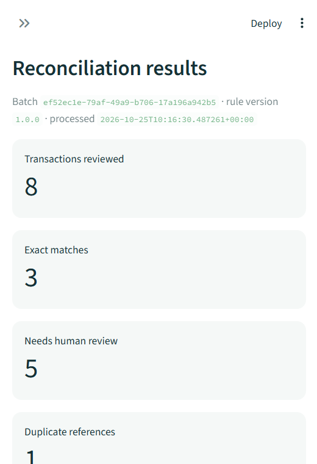
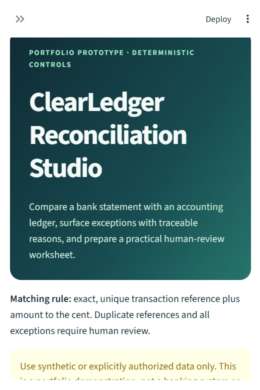
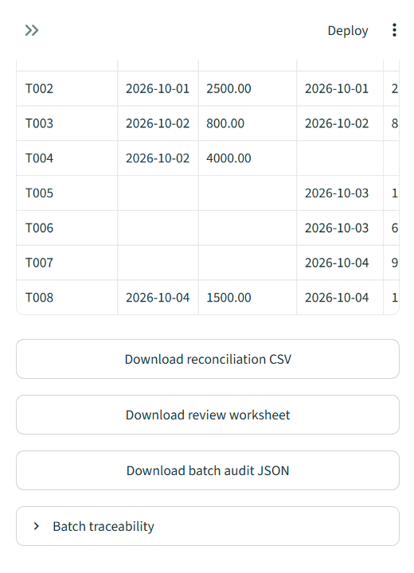

# ClearLedger Reconciliation Studio

ClearLedger is an interactive Streamlit prototype that demonstrates how a
finance team could compare a bank statement with an accounting ledger, surface
exceptions, and prepare them for human review. It is designed as a business
analysis and workflow portfolio project, with deterministic matching rules,
traceable results, and an editable capacity-planning scenario.

> **Demonstration only.** Start with the included synthetic data. Do not upload
> confidential, personal, or real financial data to a public demo. This is not
> an accounting control, production banking system, or source of financial
> advice.

## Features

- **Explore the workflow:** run the included synthetic example without
  preparing files first.
- **Bring two CSVs:** upload a bank statement and ledger export, then map their
  reference, date, amount, and optional description columns independently.
- **Validate before matching:** malformed CSVs, missing values, invalid dates,
  ambiguous headers, and amounts with more than two decimal places are rejected
  with an actionable error.
- **Reconcile deterministically:** a record is matched only when its
  case-sensitive transaction reference is unique in both sources and its
  amount agrees to the cent.
- **Review exceptions:** duplicate references, missing records, and amount
  differences receive reason codes and explanations for human investigation.
- **Inspect the batch:** review outcome counts, filter results by status, and
  inspect the batch traceability manifest.
- **Download useful outputs:** export the complete reconciliation, an
  exception-only review worksheet, and batch audit metadata as JSON.
- **Explore a business case:** adjust planning assumptions in the separate TZS
  capacity-planning page.

The prototype is rules-based and makes **no external AI calls**. Dates are
validated but are not a matching key. A match does not prove a transaction is
legitimate, authorized, or correctly posted.

## Screenshots

Screenshots below show the running prototype with its included synthetic
example data.

| App overview | Reconciliation summary |
|---|---|
|  |  |

**Results and downloads**



## Run locally (Windows PowerShell)

```powershell
py -m venv .venv
.\.venv\Scripts\Activate.ps1
python -m pip install -r requirements-dev.txt
python -m streamlit run app.py
```

If PowerShell blocks environment activation, run the environment's Python
directly:

```powershell
.\.venv\Scripts\python.exe -m pip install -r requirements-dev.txt
.\.venv\Scripts\python.exe -m streamlit run app.py
```

Streamlit opens the app in a browser. Choose **Synthetic demo data** to explore
the included example, or choose **Upload your CSVs** and provide both files.

## Run automated tests

```powershell
python -m pytest
```

## CSV format

Each file must have one column for each required field:

| Field | Required | Example |
|---|---|---|
| Transaction reference | Yes | `TX-1001` |
| Date | Yes | `2026-10-01` |
| Amount | Yes | `1250.00` |
| Description | No | `Customer payment` |

Column names do not have to match the example: map the correct columns in the
app. References are case-sensitive. Amounts may use comma thousands separators
and a dot decimal separator; amounts with more than two fractional digits are
rejected. Both sources need at least one transaction.

## Matching and exception rules

| Outcome | Rule | Review |
|---|---|---|
| Matched | A reference is unique in each file and amounts agree to the cent | No |
| Duplicate review | Reference occurs more than once in either file | Yes |
| Missing in bank statement | Unique reference exists only in the ledger | Yes |
| Missing in ledger | Unique reference exists only in the bank statement | Yes |
| Amount mismatch | Unique reference occurs in both files but amounts differ | Yes |

The prototype intentionally does not perform fuzzy matching, date matching,
currency conversion, split/combined settlement matching, journal posting, or
payment initiation. Review all exceptions against authorized source records.

## Data handling

The application processes uploads in the running Streamlit instance and does
not write uploaded source files to disk. Downloaded batch metadata includes
SHA-256 hashes, counts, a batch ID, UTC processing timestamp, and rule version;
it excludes transaction values and uploaded filenames. Formula-like text
fields are escaped in CSV downloads. When deployed to a hosted service, files
are still transmitted to that host's server; deployment privacy, retention,
access, and security must be assessed separately.

## Project layout

```text
app.py                           Streamlit application
reconciliation.py                Validation, matching, and export rules
pages/2_Business_Case.py          Editable capacity planning scenario
sample_data/                     Synthetic demo CSVs
tests/                            Reconciliation and app tests
docs/                             Process, UAT, business case, governance, case study
reports/, logs_and_evidence/      Example outputs and portfolio evidence
.github/workflows/tests.yml       Automated tests on pushes and pull requests
requirements*.txt                 Runtime and development dependencies
```

## Portfolio framing

This case study demonstrates a proposed workflow and tested prototype behavior.
It does not claim CRDB or another institution implemented the solution, that a
business user accepted it, or that forecast capacity value became cash
savings. See [`docs/portfolio-case-study.md`](docs/portfolio-case-study.md),
[`docs/responsible-ai-governance.md`](docs/responsible-ai-governance.md), and
[`docs/business-case.md`](docs/business-case.md).

## Repository and safe use

This project is published at
[github.com/steeve47/reconciliation-studio](https://github.com/steeve47/reconciliation-studio).
The included sample CSVs are synthetic. Do not commit credentials, Streamlit
secrets, private reports, or uploaded source data. A hosted demo receives
uploaded files on its server; assess hosting, access, and retention separately
before sharing it publicly. No license has been selected for this project.
